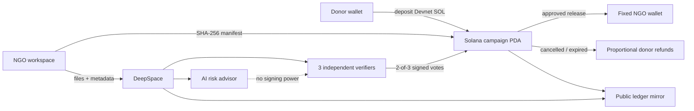

# AIDEX DeepSpace

Trust-minimized milestone funding for NGOs, built with DeepSpace and Solana Devnet.

AIDEX keeps donor funds in a program-owned Solana PDA and releases a milestone only after two of three independent verifier wallets approve the same evidence fingerprint. AI helps reviewers find risk; it never holds a key, casts a vote, or moves money.

## Why it exists

Traditional NGO funding usually asks a donor to trust a platform, a report, and the recipient's internal accounting. AIDEX narrows that trust:

- the NGO publishes milestone amounts before funding;
- donors deposit Devnet SOL directly into the campaign PDA;
- evidence files live in DeepSpace while a canonical SHA-256 manifest is committed on-chain;
- two of three independent verifier wallets attest to real-world completion;
- the Solana program alone enforces release, dispute, cancellation, and refund rules;
- every significant transition is mirrored into a readable public trust ledger.

This is deliberately described as **trust-minimized**, not magically trustless: humans still establish real-world truth, while cryptography prevents one human, one backend, or one AI model from controlling the money.

## Architecture



### DeepSpace control plane

- passwordless authentication and platform sessions;
- participant profiles for donor, NGO, and verifier roles;
- campaign, milestone, evidence, donation, vote, dispute, and ledger collections;
- realtime records and role-aware workspaces;
- R2 evidence storage;
- authenticated server actions with explicit authorization;
- OpenAI evidence-risk analysis as advisory output only.

### Solana authority plane

The Anchor program at `solana/programs/aidex_escrow` implements:

- deterministic campaign, milestone, and donor-receipt PDAs;
- immutable milestone allocation sealed to the campaign goal;
- program-owned SOL custody;
- three unique verifier wallets and a fixed two-vote threshold;
- duplicate-vote prevention through verifier bitmasks;
- permissionless release to the campaign's fixed NGO address;
- donor receipts and full proportional refunds after cancellation/expiry;
- donor/NGO disputes resolved by the same two-of-three committee;
- checked arithmetic and protected account rent reserves.

Devnet program address: `JAC2dcscjDK6AhCrubUhve9w7ttiUg9zaBzpzFjMHWLh`

## Product surfaces

- Public landing page that explains the trust model
- Role onboarding and signed wallet linking
- Donor campaign discovery, escrow inspection, and funding
- NGO Studio for campaign creation, on-chain activation, and evidence submission
- Verification Console with evidence files, AI advisory, and signed decisions
- Donor portfolio with transaction links
- Public trust ledger with transaction and evidence fingerprints
- Identity/settings page explaining the authentication boundary

## Local development

Requirements: a supported Node release (24 is used here), Rust, Anchor 1.2.2, Solana/Agave 4.1.2, and a registered DeepSpace app ID.

```bash
npm install
npm run type-check
npm run lint
npm run dev
```

Smart contract checks:

```bash
cd solana
cargo test --workspace
anchor build
```

Never commit `.dev.vars`, `solana/.keys`, or `solana/target`; they are ignored by Git.

## Security boundaries

- All amounts are integer lamports, never floating-point currency.
- Wallet binding requires a fresh signed message and is verified server-side.
- Financial record mutations are server-action only; direct client writes are denied.
- Server actions verify confirmed Devnet transactions and the exact Anchor instruction payload.
- Evidence text is treated as untrusted input in the AI prompt.
- AI output cannot satisfy an on-chain signature requirement.
- The full evidence file stays off-chain; the immutable manifest fingerprint stays on-chain.
- This is a demonstration on Devnet. It is not audited or suitable for real funds.

See [docs/DEMO.md](docs/DEMO.md) for the hiring-manager demonstration script.
